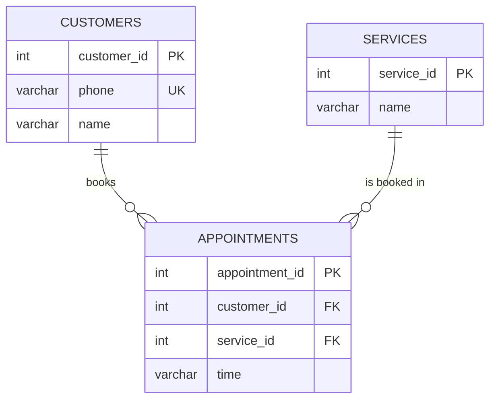

# Salon Appointment Scheduler

Interactive command-line application written in Bash, using PostgreSQL,
to book hair salon appointments: it recognizes returning customers by phone
number, registers new ones, and stores each appointment in a relational database.

> Built as part of the freeCodeCamp *Relational Database* certification.
> I document how it works and the improvements I plan to make.

## Tech stack
`Bash` · `PostgreSQL 12` · `psql` · `Git`

## Demo

```
~~~~~ MY SALON ~~~~~

Welcome to My Salon, how can I help you?

1) cut
2) color
3) perm
4) style
5) trim
2

What's your phone number?
555-1234

I don't have a record for that phone number, what's your name?
Fabio

What time would you like your color, Fabio?
10:30

I have put you down for a color at 10:30, Fabio.
```

## Features
- Dynamic service menu, read from the database (not hard-coded)
- Input validation: non-numeric or unknown choices bring the menu back
- Returning customers are recognized by phone number
- New customers are registered automatically
- Appointments are saved with the customer, the service and the time

## Database schema



- **One-to-many**: a customer can have many appointments; a service can be booked many times.
- `phone` has a `UNIQUE` constraint, so two customers cannot share a number.

## How it works

1. `PSQL` stores the base `psql` command, so each query is `$PSQL "SQL..."`.
2. `MAIN_MENU` reads the services from the database and prints them.
3. The choice is validated with a regex (`^[0-9]+$`), then checked in the database.
   If invalid, the function **calls itself** again with an error message.
4. The phone number is looked up. If absent, the customer is asked for a name
   and inserted (**get-or-create** pattern).
5. The customer id is fetched and the appointment is inserted.

## Usage

```bash
# 1. Create the database, tables and services
psql --username=freecodecamp --dbname=postgres -f salon.sql

# 2. Run the program
chmod +x salon.sh
./salon.sh
```

Check the saved data:

```bash
psql --username=freecodecamp --dbname=salon -c "
SELECT c.name, c.phone, s.name AS service, a.time
FROM appointments a
JOIN customers c USING(customer_id)
JOIN services  s USING(service_id)
ORDER BY a.appointment_id;"
```

## What I learned
- Building an interactive program in Bash (`read`, functions, recursion)
- Validating user input with regular expressions
- Querying PostgreSQL from the command line (`-t`, `--no-align`)
- Modeling relations with primary keys, foreign keys and unique constraints

## Possible improvements
- [ ] Escape single quotes in user input (e.g. `O'Brien`) to prevent SQL errors and injection
- [ ] Store `time` as a real `TIME`/`TIMESTAMP` instead of `varchar`
- [ ] Add `NOT NULL` on `phone` and `name`
- [ ] Use `read -r` and a loop instead of recursion for the menu
- [ ] Detect double bookings on the same time slot
